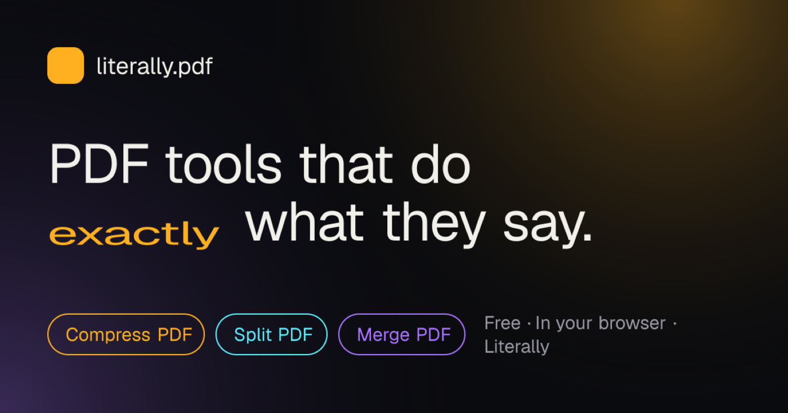
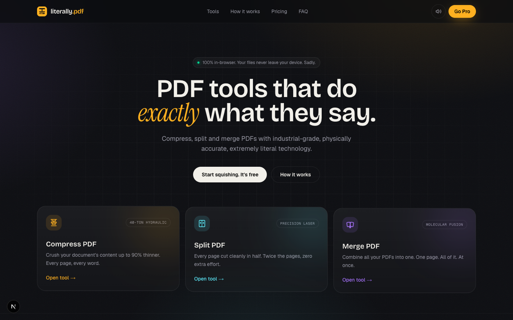
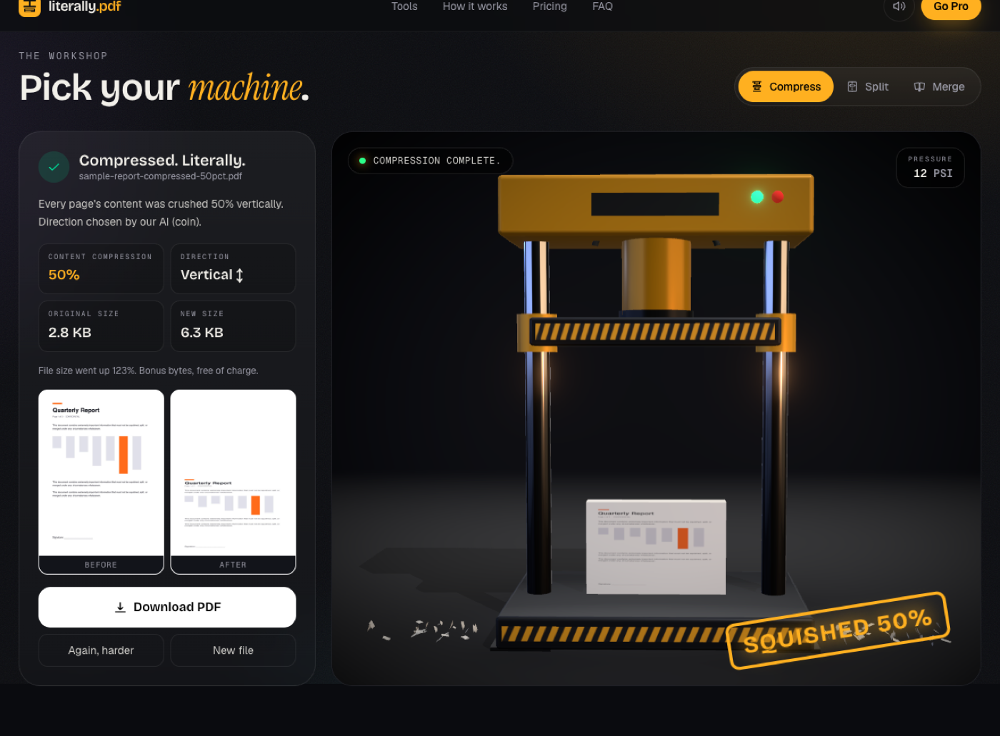
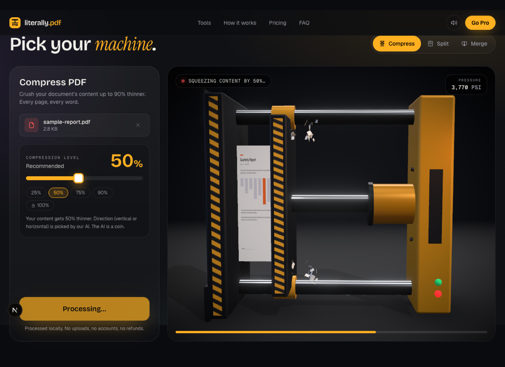
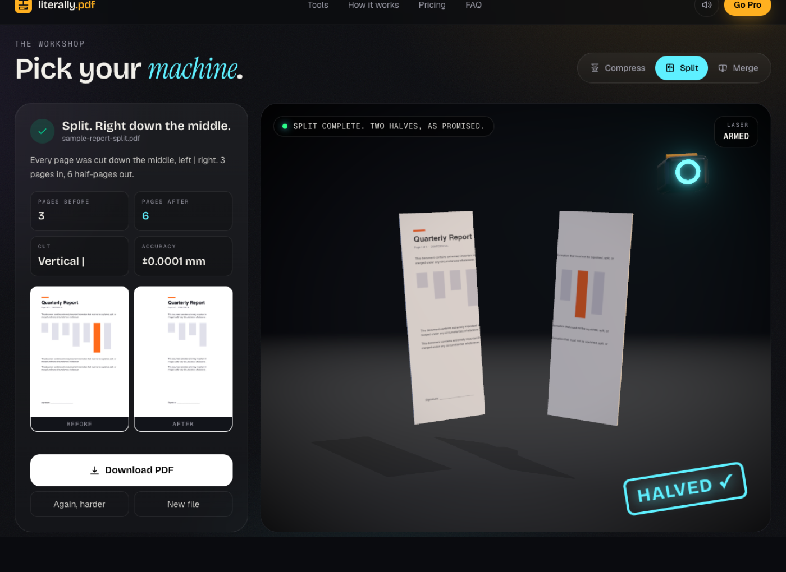
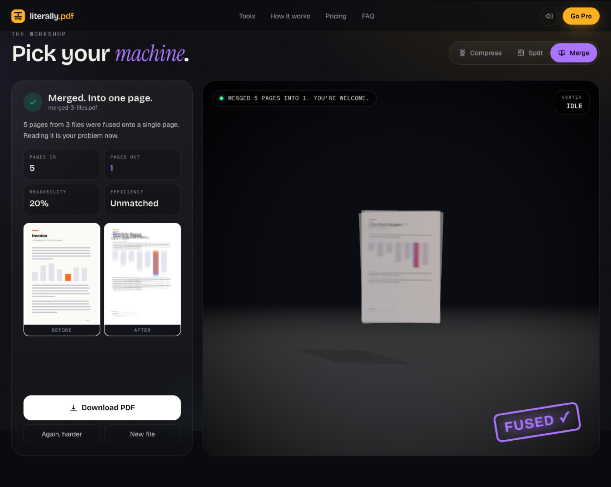
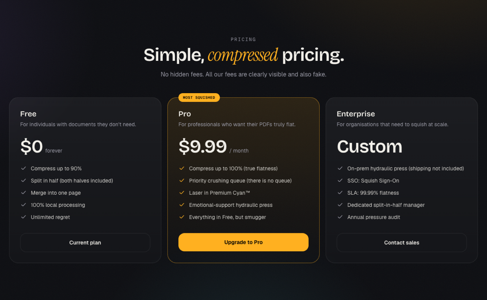

<div align="center">



# literally.pdf

**PDF tools that do _exactly_ what they say.**

Compress, split and merge PDFs with industrial-grade, physically accurate, extremely literal technology.


[](https://vercel.com/new/clone?repository-url=https%3A%2F%2Fgithub.com%2Fryccoatika%2Ftroll-pdf-tools&project-name=troll-pdf-tools&repository-name=troll-pdf-tools)

</div>

---

## What is this?

A beautifully over-engineered **troll PDF toolkit**. It looks like a premium SaaS PDF tool, and it is one. It just takes every request **literally**:

| Tool | What you expect | What you get |
| --- | --- | --- |
| 🗜️ **Compress** | A smaller file | A 40-ton 3D hydraulic press crushes your PDF. Every page, paper and content, is squeezed by the percentage you choose, vertically or horizontally (picked by our "AI", which is a coin). |
| ✂️ **Split** | Pages separated into files | A precision laser cuts **every page in half**. Down the middle or across it. 3 pages in, 6 half-pages out. |
| 🌀 **Merge** | Files joined end to end | A 9,000 RPM vortex fuses **every page of every file onto a single page**. Efficient. Unreadable. |

The output is always a **real, valid PDF**. Text stays vector text; it's just... squished.

<div align="center">
  
</div>

## Screenshots

<table>
  <tr>
    <td width="50%"></td>
    <td width="50%"></td>
  </tr>
  <tr>
    <td align="center"><b>Compress</b>: crushed 50%, vertically</td>
    <td align="center"><b>Compress</b>: when the coin says horizontal</td>
  </tr>
  <tr>
    <td width="50%"></td>
    <td width="50%"></td>
  </tr>
  <tr>
    <td align="center"><b>Split</b>: halved, as promised</td>
    <td align="center"><b>Merge</b>: 5 pages, 1 page, 20% readability</td>
  </tr>
</table>

<div align="center">
  
  <sub>Yes, there is a Pro plan. No, it does not take your card. The payment is declined <i>successfully</i>.</sub>
</div>

## Features

- 🎬 **Real-time 3D scenes** for every tool (React Three Fiber): hydraulic press with flying paper scraps and camera shake, a laser cutter with sparks and bloom, a fusion vortex with a flash.
- 📄 **Actual PDF processing** with `pdf-lib`: pages are embedded as vector XObjects and transformed, never rasterized.
- 🖼️ **Your own pages in 3D**: the first page(s) are rendered with `pdf.js` and mapped onto the 3D paper.
- 🔊 **Procedural sound effects**: hydraulic hiss, paper crunch, laser buzz, sad trombone. All synthesized with the Web Audio API, zero audio files.
- 🔒 **100% client-side**: files never leave the browser. No server, no uploads, no accounts.
- 💸 **Fake Pro plan**: 100% compression, "Split personality", "Un-merge" and other premium features that are definitely real.
- 🔎 **SEO ready**: metadata, Open Graph / Twitter images, `robots.txt`, `sitemap.xml`, web manifest and JSON-LD (`WebApplication` + `FAQPage`).
- 📱 **Responsive** down to phone width; respects `prefers-reduced-motion` for the decorative CSS animations.

## Tech stack

| Layer | Choice |
| --- | --- |
| Framework | [Next.js 16](https://nextjs.org) (App Router) + React 19 + TypeScript |
| 3D | [three.js](https://threejs.org), [@react-three/fiber](https://r3f.docs.pmnd.rs), [@react-three/drei](https://drei.docs.pmnd.rs), [@react-three/postprocessing](https://github.com/pmndrs/react-postprocessing) |
| PDF | [pdf-lib](https://pdf-lib.js.org) (write), [pdfjs-dist](https://mozilla.github.io/pdf.js/) (render) |
| UI | Tailwind CSS v4, [Motion](https://motion.dev), Zustand |
| Audio | Web Audio API (procedural) |

## Getting started

Requires **Node.js 20+**.

```bash
git clone https://github.com/ryccoatika/troll-pdf-tools.git
cd troll-pdf-tools
npm install
npm run dev
```

Open [http://localhost:3000](http://localhost:3000) and start squishing. No PDF handy? Hit **"Use a sample"**.

### Scripts

| Command | Description |
| --- | --- |
| `npm run dev` | Start the dev server |
| `npm run build` | Production build |
| `npm start` | Serve the production build |
| `npm run lint` | Lint with ESLint |

### Environment

| Variable | Required | Description |
| --- | --- | --- |
| `NEXT_PUBLIC_SITE_URL` | No | Public URL used for canonical links, sitemap, robots and social images. On Vercel it falls back to the production domain automatically, so you only need it for a custom domain. |

```bash
cp .env.example .env.local
```

## Deploy on Vercel

1. Click **Deploy with Vercel** above, or import the repo at [vercel.com/new](https://vercel.com/new). The Next.js preset needs no changes: build `next build`, install `npm install`, Node 20.9+.
2. (Optional) Add a custom domain, then set `NEXT_PUBLIC_SITE_URL=https://your-domain.com` for the **Production** environment and redeploy.

What's handled for you:

- Production URL is detected from `VERCEL_PROJECT_PRODUCTION_URL`, so canonical tags, the sitemap and Open Graph images point to the right domain.
- **Preview deployments are not indexed**: they serve `Disallow: /` in `robots.txt` and `noindex, nofollow` meta tags, so search engines only see production.
- Everything else is static: the page, icons, OG images, `robots.txt` and `sitemap.xml` are prerendered at build time. No serverless functions or env secrets needed.
- Security headers (`nosniff`, `Referrer-Policy`, `X-Frame-Options`, `Permissions-Policy`) are set in `next.config.ts`.

## How the trolling works

```
src/
├── app/                     # layout, page, SEO metadata routes (robots, sitemap, OG image…)
├── components/
│   ├── three/
│   │   ├── PressScene.tsx   # hydraulic press (rotates 90° for horizontal mode)
│   │   ├── SplitScene.tsx   # laser cutter + halves parting ways
│   │   ├── MergeScene.tsx   # page vortex → flash → fused stack
│   │   ├── Stage.tsx        # canvas, lights, local environment, bloom
│   │   └── shared.tsx       # camera rig, run clock, debris/sparks, easing
│   ├── Workspace.tsx        # tool flow: upload → animate + process → result
│   └── …                    # hero, pricing, FAQ, Pro modal, toast
└── lib/
    ├── pdf.ts               # compress / split / merge with pdf-lib
    ├── render.ts            # pdf.js page rendering
    ├── sound.ts             # Web Audio sound engine
    └── site.ts              # SEO config + FAQ copy
```

- **Compress**: each page is embedded and redrawn on a page whose height (or width) is `1 - percent` of the original, so paper and content are crushed together like they left the press.
- **Split**: each page is embedded twice with a half-page bounding box, producing two half-size pages.
- **Merge**: every page from every file is drawn onto one page with reduced opacity and a little random rotation.

The 3D animation and the PDF job run in parallel; the result appears when both finish.

## Disclaimer

This is a joke project. Please don't use it on your tax return. Or do, we can't stop you. It runs in your browser.

<div align="center">
  <sub>No PDFs were harmed in the making of this project. Several were flattened.</sub>
</div>
